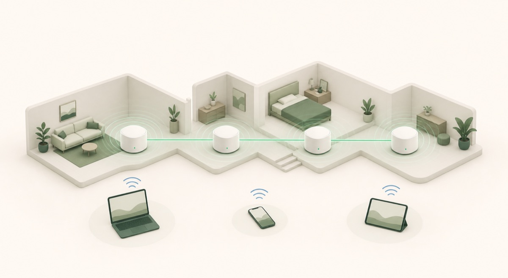

# HomeScope

HomeScope is a local-first home-network monitor for macOS. It combines LAN
discovery, router and access-point client tables, device history, DNS activity,
traffic sensors, and a responsive network map in one dashboard.



HomeScope was built for a four-node home network and published as an open-source
DIY project so it can be adapted to other routers, layouts, and monitoring
setups. Network history and router credentials stay on the machine running the
collector.

## Features

- live online/offline inventory with first-seen and last-seen history
- direct access-point attribution when a supported router reports its stations
- separate direct, downstream, and branch client counts
- editable device names, owners, categories, groups, and map zones
- router/AP health checks and homepage shortcuts
- zoomable building map with AP-based device-location estimates
- live Server-Sent Events updates without full-page refreshes
- day, week, and month per-device traffic totals through ntopng
- searchable DNS and domain activity through NextDNS, Pi-hole, or AdGuard Home
- activity timeline, CSV export, notification controls, themes, and dark mode
- PIN-protected D-Link deny-list controls with infrastructure safeguards
- macOS menu-bar application and background-service templates

## Privacy model

HomeScope is designed to run on a trusted Mac inside the network it monitors.
The local SQLite database, `.env.local`, ntopng data, passwords, tokens, device
MAC addresses, and DNS history are ignored by Git and must never be committed.

The collector never decrypts HTTPS. Domain sensors see DNS names, not exact page
paths or message contents. VPNs, Private Relay, encrypted DNS, randomized MAC
addresses, and AP firmware limitations can reduce attribution accuracy.

## Requirements

- macOS 13 or newer
- Node.js 22.13 or newer
- npm
- optional: ntopng and Redis for traffic visibility
- optional: NextDNS, Pi-hole, or AdGuard Home for DNS history

## Quick start

```bash
git clone https://github.com/iazifofficial/homescope.git
cd homescope
cp .env.example .env.local
npm install
npm run dev
```

Open [http://localhost:3000](http://localhost:3000). One development command
starts the dashboard, the collector at `127.0.0.1:4318`, and a local SQLite
database under `data/`.

HomeScope works without router credentials as a general LAN inventory. Add only
the credentials for routers you own and are authorized to manage. Credentials
remain server-side and are never included in browser snapshots.

## Configuration

Edit `.env.local` after copying the example file.

| Variable | Purpose |
| --- | --- |
| `NETWORK_SUBNET` | IPv4 `/24` prefix to scan, such as `192.168.1` |
| `SCAN_INTERVAL_SECONDS` | Full LAN discovery interval |
| `ASSOCIATION_INTERVAL_SECONDS` | Direct AP client-table refresh interval |
| `NEXT_PUBLIC_HOMESCOPE_DISPLAY_NAME` | Optional dashboard greeting name |
| `SLT_*`, `ZLT_*`, `DLINK_*`, `TPLINK_*` | Optional built-in router adapters |
| `NEXTDNS_*`, `PIHOLE_*`, `ADGUARD_*` | Optional domain-history providers |
| `NTOPNG_*` | Optional bandwidth and application sensor |

The included topology assumes a main router at `192.168.1.1` followed by three
LAN-connected access points at `.2`, `.3`, and `.4`. Router definitions and
topology links are near the top of `collector/server.mjs`; contributors can
replace them or add adapters for other hardware.

Current direct-client adapters target the original project hardware:

- SLT FD602-series firmware
- ZLT JSON management API
- D-Link DIR-853 HNAP API
- a legacy TP-Link wireless-station status page

Unsupported routers still participate in reachability checks and general LAN
discovery, but HomeScope will label their direct client table as unavailable
instead of inventing an association.

## Traffic and domain visibility

NextDNS, Pi-hole, and AdGuard Home provide DNS activity. DNS data cannot measure
transferred bytes.

ntopng provides traffic counters and application estimates. To measure every
device accurately, ntopng must receive traffic from the gateway, a managed
switch SPAN port, or a network TAP. Capturing only the Mac's normal Wi-Fi
interface cannot see every other client's unicast traffic.

## macOS application

```bash
npm run desktop:app
```

The Electron controller provides a menu-bar icon and opens the local dashboard.
The `ops/` directory contains launchd templates for keeping the collector,
dashboard, and optional sensors running. Replace `YOUR_USERNAME` in those
templates before installing them.

The first device-control PIN is `0000`; change it immediately in HomeScope
Settings before enabling device blocking.

## Commands

```bash
npm run dev          # dashboard and collector
npm run collector    # collector only
npm run build        # production build
npm run lint         # code-quality checks
npm test             # build and rendered-output tests
npm run desktop:app  # unpacked macOS application
npm run desktop:dmg  # macOS DMG
```

## Development

See [CONTRIBUTING.md](CONTRIBUTING.md) for the project structure, adapter
guidelines, verification steps, and pull-request expectations. Security and
privacy reports are covered by [SECURITY.md](SECURITY.md).

## Remote deployment

HomeScope is local-first. An optional split dashboard/VPS design is documented
in [CLOUD_DEPLOYMENT.md](CLOUD_DEPLOYMENT.md). Never expose router administration
pages directly to the public internet.

## License

HomeScope is available under the [MIT License](LICENSE).
